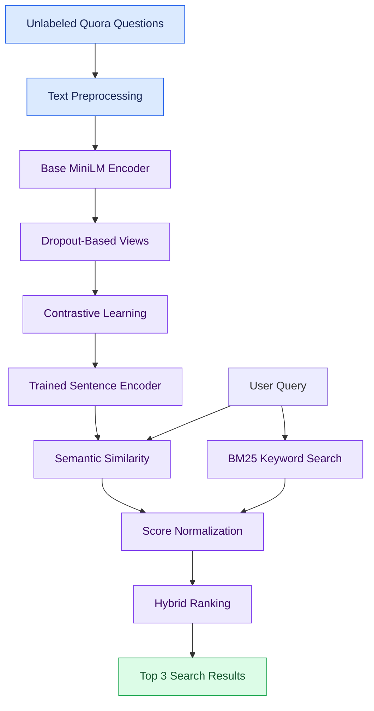

# 🔍 Self-Supervised Semantic Search Using Contrastive Representation Learning

<p align="center">
  <strong>Search by meaning, not just keywords.</strong>
  <br />
  An NLP project combining self-supervised SimCSE-style learning with BM25 keyword search.
</p>

<p align="center">
  
  
  
  
  
</p>

---

## 📌 Overview

Traditional keyword search often fails when a query and a document express the same idea using different words.

For example:

- **Query:** "Where can I find a cheap place to sleep?"
- **Document:** "Our family guesthouse offers affordable accommodation."

A keyword-based system may miss this connection. A semantic search system attempts to recognize that the two sentences have similar meanings.

This project develops a lightweight **hybrid semantic search system** that combines sentence embeddings learned through self-supervised contrastive learning with BM25 keyword retrieval.

The goal is to explore how unlabeled data can improve semantic representations and how combining semantic and lexical search can produce more relevant results.

## ✨ Key Features

- 🧠 **Self-supervised learning** — trains sentence representations without using labels.
- 🔗 **Contrastive learning** — uses SimCSE-style dropout noise to create positive sentence pairs.
- 🔎 **Semantic search** — retrieves text based on meaning rather than exact word matches.
- 📝 **BM25 integration** — combines semantic similarity with traditional keyword relevance.
- 📊 **Baseline evaluation** — compares the model with TF-IDF, BM25, and a pretrained sentence encoder.
- 🌐 **Interactive web demo** — searches text files through a simple Gradio interface.
- 💻 **CPU-friendly training** — designed to run on a laptop without a dedicated GPU.

## 🏗️ System Architecture



## ⚙️ How It Works

### 1. Dataset Preparation

The project uses question text from the Quora Question Pairs dataset, accessed through the Hugging Face GLUE benchmark (`nyu-mll/glue`, configuration `qqp`).

- Training data: 20,000 sentences
- Test queries: 2,000
- Training labels: not used
- Test split: held out from training

### 2. Self-Supervised Contrastive Learning

The base encoder is `nreimers/MiniLM-L6-H384-uncased`, which is not a sentence-embedding model pretrained for semantic similarity.

Each training sentence passes through the encoder twice. Dropout produces two slightly different representations of the same sentence.

These representations form a positive pair, while other sentences in the batch act as negatives.

The model learns to bring the positive representations closer together and distinguish them from unrelated examples using `MultipleNegativesRankingLoss`.

### 3. Hybrid Retrieval

The trained encoder measures semantic similarity between the query and candidate sentences. BM25 independently calculates lexical relevance.

The scores are normalized and combined:

\[
S_{\text{hybrid}} = 0.7S_{\text{semantic}} + 0.3S_{\text{BM25}}
\]

The weights were selected using a separate set of 2,000 pairs rather than the test pairs.

### 4. Interactive Search Demo

The Gradio application:

1. Accepts a natural-language query.
2. Loads text documents from `demo.txt`.
3. Calculates semantic and BM25 relevance scores.
4. Ranks the documents using the hybrid score.
5. Displays the three highest-ranked results.

You can replace the sample text with your own content.

## 📊 Experimental Results

The system was evaluated on 2,000 test questions against 2,000 candidate questions using Quora duplicate-question retrieval.

| Method | Recall@1 | Recall@5 | Recall@10 | MRR |
|:--|--:|--:|--:|--:|
| Raw MiniLM | 0.600 | 0.798 | 0.854 | 0.689 |
| **Self-Supervised SimCSE** | **0.683** | **0.875** | **0.931** | **0.768** |
| BM25 | 0.733 | 0.925 | 0.967 | 0.816 |
| TF-IDF | 0.744 | 0.919 | 0.963 | 0.821 |
| **Hybrid: SimCSE + BM25** | **0.755** | **0.935** | **0.979** | **0.837** |
| Pretrained all-MiniLM-L6-v2 | 0.810 | 0.963 | 0.991 | 0.876 |

*Higher scores are better.*

### 📈 What the Results Tell Us

- **Self-supervised learning helps:** Recall@1 improves from 0.600 to 0.683 compared with the raw encoder.
- **Keyword search remains competitive:** BM25 and TF-IDF outperform the trained encoder on this particular test.
- **Hybrid retrieval performs best among the methods evaluated without labels:** Recall@1 reaches 0.755 and MRR reaches 0.837.
- **Pretrained sentence embeddings remain stronger:** `all-MiniLM-L6-v2` achieves the highest overall scores in this comparison.

These results suggest that combining semantic and lexical signals can improve retrieval, even when sentence representations are learned without labels.

> **Note:** The results come from a single experimental run. Further runs with different random seeds would be needed to assess statistical significance.

## 🛠️ Tech Stack

| Technology | Purpose |
|:--|:--|
| Python | Core implementation |
| PyTorch | Deep learning framework |
| Sentence-Transformers | Sentence encoding and contrastive training |
| Hugging Face Datasets | Dataset loading |
| MiniLM | Base sentence encoder |
| BM25 (`rank-bm25`) | Keyword-based retrieval |
| scikit-learn | TF-IDF and evaluation utilities |
| Gradio | Interactive web interface |

## 📁 Project Structure

```text
semantic-search/
│
├── train.py           # Self-supervised contrastive training
├── baselines.py       # Baseline methods and evaluation
├── hybrid.py          # Hybrid retrieval and evaluation
├── demo_app.py        # Interactive Gradio application
├── demo.txt           # Sample searchable documents
├── requirements.txt   # Python dependencies
├── README.md          # Project documentation
│
└── simcse-model/      # Generated after training (not committed)
```

## 🚀 Getting Started

### Prerequisites

- Python 3.12 recommended
- Git
- Internet connection for the initial dataset and model downloads

### 1. Clone the Repository

```bash
git clone https://github.com/salman-anik/semantic-search.git
cd semantic-search
```

### 2. Create a Virtual Environment

**Windows**

```bash
py -3.12 -m venv venv
venv\Scripts\activate
```

**macOS / Linux**

```bash
python3.12 -m venv venv
source venv/bin/activate
```

### 3. Install Dependencies

```bash
python -m pip install --upgrade pip
pip install -r requirements.txt
```

### 4. Evaluate the Baselines

```bash
python baselines.py
```

This step is optional and compares the existing retrieval approaches.

### 5. Train the Model

```bash
python train.py
```

The trained encoder is saved to `simcse-model/`.

### 6. Evaluate Hybrid Search

```bash
python hybrid.py
```

This compares the trained model with BM25 and the hybrid approach.

### 7. Launch the Web Demo

```bash
python demo_app.py
```

Open the local URL printed in your terminal, usually:

**http://127.0.0.1:7860**

Enter a query and explore the matching text.

## 📝 Search Your Own Documents

1. Open `demo.txt`.
2. Replace the sample content with your own text.
3. Put each document or passage on a separate line.
4. Save the file using UTF-8 encoding.
5. Search again in the Gradio interface.

The application reloads the text file on the next search.

To use another filename, update `DOC_FILE` in `demo_app.py`.

## 🎯 Potential Applications

This project could be adapted for:

- 📚 Semantic search across lecture notes and study materials
- ❓ Duplicate-question detection in Q&A platforms
- 🏢 FAQ retrieval for organizations and businesses
- 🎫 Searching customer support tickets
- 📄 Searching notes, documents, and knowledge bases

These are potential applications, not currently deployed services.

## ⚠️ Limitations

- The model was trained on only 20,000 sentences for one epoch.
- Training and evaluation focus on English Quora questions.
- Short question retrieval may favor keyword-based methods.
- Performance on long documents and other domains has not been established.
- Only one training run and random seed were used.
- The demo always returns up to three results, even when none is a good answer.
- The pretrained comparison model uses additional training data and labeled pairs, so it is not a like-for-like comparison.

## 🔬 Future Improvements

- Train on a larger and more diverse unlabeled corpus.
- Experiment with more epochs, batch sizes, and learning rates.
- Evaluate across multiple random seeds.
- Test on longer documents and domain-specific datasets.
- Add configurable result counts and relevance thresholds.
- Explore multilingual semantic retrieval.
- Improve inference speed for larger document collections.

## 📚 References

1. Gao, T., Yao, X., & Chen, D. (2021). [SimCSE: Simple Contrastive Learning of Sentence Embeddings](https://aclanthology.org/2021.emnlp-main.552/). EMNLP 2021.
2. Reimers, N., & Gurevych, I. (2019). [Sentence-BERT: Sentence Embeddings using Siamese BERT-Networks](https://aclanthology.org/D19-1410/). EMNLP-IJCNLP 2019.
3. [Sentence-Transformers Documentation](https://www.sbert.net/)
4. [Hugging Face Datasets](https://huggingface.co/docs/datasets)
5. [rank-bm25](https://pypi.org/project/rank-bm25/)
6. [Gradio Documentation](https://www.gradio.app/docs)

## 👨‍💻 Author

**Salman Anik**

Computer Science & Engineering Student | Data Science Enthusiast

- GitHub: [@salman-anik](https://github.com/salman-anik)
- LinkedIn: [Salman Anik](https://www.linkedin.com/in/salman-anik-5a7015294/)
- LeetCode: [salmananik](https://leetcode.com/u/salmananik/)

---

<p align="center">
  ⭐ If you find this project interesting, consider starring the repository.
  <br />
  Part of my <strong>Road to AI</strong> learning journey.
</p>
